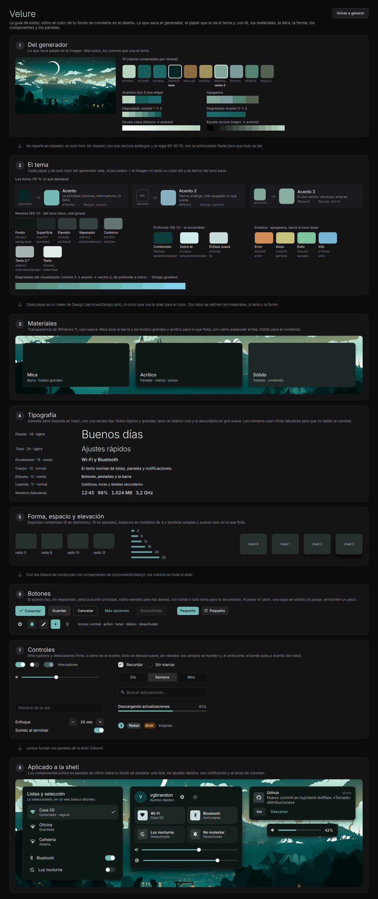

# Velure

El sistema de diseño de la shell. El nombre viene de *velours* (terciopelo, en francés) y
de *velo*: un tema suave y elegante, como un traje de gala, con paneles translúcidos
que dejan ver el fondo como a través de un velo.

Junta lo funcional de **Material You**, el acabado de **macOS** y el material de
**Windows 11**. Los colores salen siempre del fondo de pantalla con el generador propio,
**paleta** (ver [La paleta](#la-paleta)), así que todo cambia con el fondo.

La guía de estilo en vivo se abre con `quickshell ipc call styleguide toggle` (o «Guía de
estilo» en el lanzador).

Las rutas son relativas a `~/.config/quickshell/` (en este repo,
`home/dot_config/quickshell/`); las del greeter, a `~/.config/quickshell-greeter/`.

- Tokens: `services/Design.qml`
- Componentes: `components/design/`
- Guía de estilo (todos los tokens y componentes con ejemplos que se pueden usar):
  `quickshell ipc call styleguide toggle` (`modules/styleguide/`)
- Toda la shell lo usa: la barra (`modules/bar/`), los paneles, las ventanas y las
  pantallas de bloqueo e inicio de sesión. Ver [Cómo se aplica](#cómo-se-aplica-al-resto-de-la-shell).

## Principios

1. **Elegante: contención.** El fondo de todo es un tono muy oscuro y apagado del color
   del fondo de pantalla; las superficies suben desde él con un poco de blanco. **Un
   solo acento**, el primario oscurecido y desaturado (burdeos, petróleo…, nunca
   pastel), y solo para la acción principal, el interruptor encendido y lo lleno de
   deslizadores y barras. Lo demás que se resalta (escritorio activo, mosaicos
   encendidos, casillas, insignias) va en **blanco roto** (`hi`, `AccentFill {
   secondary: true }`) y lo elegido, en un velo blanco discreto (`selection`). Sin
   brillos ni resplandores. `Theme.primary` apunta al mismo acento.
2. **Transparencia de Windows 11.** **Mica** para la barra y los fondos grandes y
   **acrílico** para lo que flota (paneles, menús, avisos), los dos casi opacos para
   que se lean con cualquier fondo. La barra va pegada al borde, no flota.
3. **Detalles finos.** Borde de 1 px semitransparente y el canto del vidrio
   (`GlassEdge`: brillo especular de 1 px arriba), sombras
   amplias y suaves solo en lo que flota, títulos ligeros y grandes, controles finos y
   cifras tabulares en los números.
4. **Esquinas contenidas.** Radios de 6 en los elementos y 10 en los paneles; lo de
   dentro siempre más pequeño que lo de fuera y nada de píldoras salvo interruptores.
5. **Movimiento suave.** Sin rebotes: lo que se desliza (interruptor, segmentado,
   escritorio activo) frena con suavidad, y los botones se hunden un poco al pulsarlos.

## Tokens (`Design.*`)

### Color

| Token | Respaldo (nombre Material) | Uso |
| --- | --- | --- |
| `background` | `surface_dim` | Lo más bajo; tinte de la Mica y del vidrio |
| `surface0` | `surface_container_low` | Campos de texto (hundidos) |
| `surface1` | `surface_container` | Tarjetas (contrastan sobre el vidrio) |
| `surface2` | `surface_container_high` | Mosaicos, segmentado, elementos sobre tarjetas |
| `surface3` | `surface_container_highest` | Pistas de interruptores y deslizadores |
| `onSurface` / `onSurfaceVariant` / `muted` | `on_surface` / `on_surface_variant` | Texto principal / secundario / apagado |
| `accent` / `onAccent` | `primary` oscurecido y desaturado / blanco | Acción principal, encendido, lo lleno |
| `hi` / `onHi` | blanco roto / casi negro | Énfasis secundario: escritorio activo, mosaicos, casillas |
| `accent2` | = `accent` | Se mantiene por compatibilidad (ya no hay degradado) |
| `selection` / `selectionBorder` | blanco al 6 % / 12 % | Lo elegido: filas, opciones, mosaicos encendidos |
| `sunken` / `raised` | negro al 22 % / blanco al 9 % | Campos y pistas (hundido) / botones tonales (elevado) |
| `accentContainer` / `onAccentContainer` | `primary_container` | Mosaicos encendidos, avatar |
| `tonal` / `onTonal` | `secondary_container` | Lo activo y lo seleccionado |
| `outline` / `outlineVariant` | `outline` / `outline_variant` | Bordes de casillas y campos / separadores |
| `error`, `success`, `warning`, `info` | `error`, `green`, `yellow`, `blue` | Estados (armonizados con el fondo) |
| `hoverLayer` / `pressLayer` | `on_surface` al 8 % / 12 % | Capa de estado encima de cualquier color |
| `border` / `borderHighlight` | `on_surface` al 10 % / 32 % | Borde de 1 px y brillo del canto |

### Materiales

| Material | Tinte | Opacidad | Dónde |
| --- | --- | --- | --- |
| Mica | `micaTint` (`background`) | `micaOpacity` 0.88 | Barra, fondos grandes |
| Acrílico | `glassTint` (`background`, el mismo que la barra) | `glassOpacity` 0.9 | Paneles, menús, notificaciones, avisos |
| Sólido | `surface1` | 1 | Contenido, tarjetas dentro de un panel |

Las opacidades solo se aplican con **Ajustes → Barra y paneles translúcidos**
encendido; apagado, todos los materiales son opacos (`micaOpacity` y `glassOpacity`
valen 1).

La misma opción vuelve translúcido el **fondo** de las apps que lo permiten, con el
texto nítido y el desenfoque de Hyprland detrás, al 88 % como la barra (`opacity` en
`translucent.sh`).

- kitty (`background_opacity`).
- Zed: el tema Velure con `background.appearance: blurred`. Necesita reiniciarse
  la primera vez para crear su ventana transparente.
- Las apps GTK3 con el tema «Velure», como Thunar: el tema importa `translucent.css`.
- Firefox: el marco (pestañas, barras y barra lateral) y la nueva pestaña, con el
  mismo tono que la barra; las demás páginas pintan su propio fondo. Un autoconfig
  de Firefox (`~/.config/velure/firefox/velure.cfg`, lo instala en `/usr/lib/firefox`
  `run_onchange_after_firefox-autoconfig.sh` con sudo) carga en el marco, **en vivo**,
  los colores de la paleta (`firefox-userChrome.css`) y la capa translúcida
  (`~/.local/state/velure/firefox-translucent.css`). La nueva pestaña va en
  `userContent.css` entre marcas y se ve al reiniciar Firefox (las páginas no admiten
  estilos en vivo). `translucent.sh` activa `browser.theme.native-theme` (sin el tema GTK, Firefox pinta su propio tema
  oscuro debajo de todo y tapa lo de detrás). El CSS del marco también vuelve
  transparente el `body` de la ventana, que según tenga el foco o no pinta debajo los
  colores del sistema, opacos.

Lo hace `~/.config/velure/scripts/translucent.sh`. Lo llaman Quickshell al cambiar la
opción y paleta al regenerar los temas.

El desenfoque de verdad lo hace Hyprland: la regla de capa de `hyprland.lua` desenfoca
los namespaces `quickshell:(bar|config-panel|notification-center|ai|osd)`. Una ventana
nueva con material transparente necesita su namespace en esa regla.

### La paleta

Los colores salen de `~/.local/bin/paleta` (proyecto `~/generador-de-paleta`: el
generador en JavaScript, réplica de gradients.app, y su port a Rust en `rust/`, que da
exactamente los mismos colores). `Theme.setWallpaper` ejecuta `paleta aplicar <fondo>`:

1. Saca de la imagen sus secciones: 10 colores, acentos y degradados, apagados y escalas
   clara y oscura.
2. Las reparte en papeles con la luminosidad fijada en OKLCH (`roles.rs`, modo
   **armónico**, el de por defecto): un solo tono (el color que más ocupa en la imagen, contando que tenga color: presencia × croma; el orden del generador, por viveza, favorece los claros) con
   armonía análoga (acentos 2 y 3 = sus vecinos en el círculo cromático, más apagados) y
   la regla 60-30-10 (neutros con un toque del tono, el tono en profundo para lo
   encendido, poco acento); saturación contenida y estados apagados. `--modo libre`:
   cada acento de un color distinto de la imagen. Imagen gris: acento de respaldo. El degradado del visualizador abre el abanico análogo (acento 3 → acento → acento 2) con una rampa de luz, de profundo a claro.
3. Rellena las plantillas de `~/.config/velure/config.toml` (`[templates.*]` con
   `{{colors.ROL.default.hex}}` e `{{image}}`) y ejecuta sus ganchos: kitty, Zed, GTK3
   y GTK4 (tema «Velure»), iconos, Starship, eza, Firefox y Tidal.
4. Devuelve la paleta: los nombres de Material (`primary`, `surface_container`…) para lo
   que ya los usa, y los papeles propios con prefijo `p_` (`p_background`, `p_accent2`,
   `p_gradient_0`…), que `Design.qml` usa primero (`Design.p()`).

Volver a aplicarla al fondo actual: `quickshell ipc call palette apply`. Comparar cómo quedaría con otros fondos:
`quickshell ipc call paletas toggle` (`paleta roles`).

### Tipografía

Fuente `Adwaita Sans` (basada en Inter); `JetBrainsMono Nerd Font` para lo monoespaciado.
Los iconos siguen siendo los de Nerd Font (`Theme.i*`). Los que no trae (como el logo de
Bitwarden) están en una fuente propia, **Velure Icons** (`assets/fonts/VelureIcons.ttf`),
para que se vean igual de nítidos: se dibujan como letras, no como imágenes, y como la
Nerd Font es TrueType con ajuste a los píxeles (ttfautohint). Se dibujan al estilo de
Material Design Icons (rejilla de 24, trazo de 2) para que pesen igual que los demás.
Para añadir uno: su SVG en `assets/icons/<nombre>.svg`, su código en
`assets/icons/iconos.json` (área privada `U+100000…`; `"grid": true` si está dibujado en
la rejilla de Material), `scripts/build-icons.py` (ver su cabecera) y `Theme.i<Nombre>`.
`Icon` usa esa fuente sola para esos códigos y centra los iconos por su ancho
tipográfico, en píxeles enteros.
Ningún icono queda centrado al píxel en todos los casos (forma propia, redondeo): se
centran a ojo con el **editor de iconos** (Ajustes → Ajustar iconos, o
`quickshell ipc call iconeditor toggle`), que muestra cada icono de la barra ampliado ×12
con la cruz del centro de su caja y lo mueve de píxel en píxel. Los cambios se ven al
momento y se conservan con **Guardar** (cerrar sin guardar los descarta); se guardan por
icono y tamaño en `icon-offsets.json` (`services/IconOffsets.qml`) y `Icon` lo aplica
solo en toda la shell. Para un caso puntual, `offsetX` / `offsetY` de `Icon` (o
`iconOffsetX` / `iconOffsetY` de `IconBtn`) se suman a lo guardado.

| Estilo | Tamaño | Peso | Uso |
| --- | --- | --- | --- |
| `display` | 34 | seminegrita, espaciado −0,6 | Saludos, números grandes |
| `title` | 22 | seminegrita, espaciado −0,3 | Títulos de ventanas y secciones |
| `headline` | 15 | seminegrita | Encabezados dentro de un panel |
| `body` | 13 | normal | Texto normal |
| `label` | 12 | media | Botones, pestañas, la barra |
| `caption` | 11 | normal | Subtítulos, horas, detalles |

Números que cambian (hora, porcentajes, contadores): `font.features: { "tnum": 1 }`.

### Forma, espacio, elevación y movimiento

- Radios: `radiusXs` 3, `radiusSm` 6 (botones, filas, casillas), `radiusMd` 10
  (paneles, mosaicos), `radiusLg` 12.
- Espacios: múltiplos de 4 (`Design.space`: 0, 4, 8, 12, 16, 20, 24, 32).
- Elevación (`Design.elevation[0..3]`): 0 en lo que va pegado (barra), 1 en tarjetas,
  2 en paneles y avisos, 3 en lo más alto (centro de control).
- Movimiento: `fast` 120 ms (capas de estado), `normal` 200 ms (cambios de estado),
  `slow` 320 ms; curva `easing` (OutCubic). Lo que se desliza usa `spring` (OutQuint,
  sin rebote) y `springDuration` 320 ms.

## Componentes (`import qs.components.design`)

| Componente | Para qué | Ejemplo |
| --- | --- | --- |
| `Txt` | Texto con un estilo de la escala | `Txt { text: "Hola"; textStyle: Design.headline }` |
| `Surface` | Fondo con material, borde, brillo y sombra; con `backdrop` desenfoca esa imagen detrás (vidrio esmerilado de verdad) | `Surface { material: "glass"; elevation: 2 }` |
| `GlassEdge` | El canto del vidrio: brillo de 1 px arriba (dentro de un fondo, antes del contenido) | `GlassEdge { inset: radius }` |
| `AccentFill` | Relleno liso del acento; `secondary` = en blanco roto (dentro de lo que se rellena) | `Rectangle { AccentFill {} }` |
| `Btn` | Botón con texto: `filled`, `tonal`, `outline`, `text` | `Btn { kind: "filled"; text: "Conectar" }` |
| `IconBtn` | Botón de icono: `plain`, `tonal`, `filled`; `checked` = activo | `IconBtn { icon: Theme.iBell; checked: true }` |
| `Toggle` | Interruptor | `Toggle { checked: true; onToggled: … }` |
| `Slide` | Deslizador | `Slide { value: 0.4; onMoved: v => … }` |
| `Segmented` | Control segmentado | `Segmented { options: ["Día", "Mes"] }` |
| `Check` | Casilla con texto | `Check { text: "Recordar" }` |
| `Field` | Campo de texto (al enfocarlo, el borde en acento, sin halo); `big: true` es el buscador grande de las ventanas (lanzador, portapapeles, atajos, Bitwarden). `focusInput()` le da el foco y `keyPressed(e)` deja manejar teclas (flechas, Enter…) | `Field { icon: Theme.iSearch; placeholder: "Buscar" }` |
| `ListRow` | Fila de lista; `selected` = selección de acento | `ListRow { icon: …; title: …; subtitle: … }` |
| `Tile` | Mosaico de ajuste rápido | `Tile { icon: Theme.iWifi; title: "Wi-Fi"; checked: true }` |
| `NumberStep` | Ajuste numérico: nombre y − valor + | `NumberStep { label: "Enfoque"; value: 25; unit: "min"; onChanged: v => … }` |
| `ToggleRow` | Fila con texto e interruptor | `ToggleRow { text: "Sonido"; checked: …; onToggled: … }` |

Reglas al usarlos:

- Colores, tamaños, radios y tiempos siempre desde `Design`, nunca a mano.
- Todo lo que se pulsa lleva capa de estado (`hoverLayer` / `pressLayer`) y cursor de mano.
- Lo activo, tonal; el acento sólido, solo para lo principal.
- `Toggle` y `Segmented` cambian solos al pulsarlos; con `follow: false` solo avisan
  y el estado lo decide quien los usa (lo normal al reflejar un servicio).
- Los paneles (`BarPopup`, `SidePanel`, `OverlayWindow`) ya son de vidrio: lo de
  dentro solo usa tokens y componentes.
- `Surface` con `backdrop` (una imagen) desenfoca la parte de esa imagen que tiene
  detrás: lo usan la guía (sobre la franja del fondo) y las pantallas de bloqueo e inicio de sesión. Si la
  superficie se mueve dentro de otra cosa, pásale algo que cambie con ese movimiento en
  `scrollY` (p. ej. `card.x + card.y`) para que se recoloque. En el escritorio se deja
  `backdrop` vacío y desenfoca Hyprland.

## La guía de estilo

`quickshell ipc call styleguide toggle` abre una ventana flotante que recorre, como la
guía de paletas y con sus mismas piezas (`modules/palettes`: `PaletteData`,
`GeneratorStep`, `ThemeStep`, `GuideStep`, `GuideArrow`…), cómo el color del fondo se
convierte en el diseño: 1) lo que saca el generador de la imagen, 2) el tema: cada papel,
de qué color del generador sale y qué token de `Design` lo usa, 3–5) materiales,
tipografía y forma, 6–7) botones y controles, 8) aplicado a la shell (lista, ajustes
rápidos, notificación, aviso de volumen). Los materiales y los ejemplos de vidrio van
sobre una franja con el fondo de pantalla (`Stage.qml`, paneles `GlassCard.qml`), para
que se vea la transparencia. Es el sitio para
probar cambios del diseño antes de aplicarlos: al tocar `Design.qml` o un componente,
la guía se actualiza. `quickshell ipc call styleguide scrollTo <y>` la desplaza (para
capturas).

## Cómo se aplica al resto de la shell

El diseño llega a casi todo a través de los componentes compartidos, que ya usan los
tokens de `Design` con la API de siempre:

- Contenedores: `BarPopup` (paneles de la barra, todos de `Design.popupWidth` = 360 px
  de ancho; los menús, como el de la bandeja, son más estrechos), `SidePanel` (ajustes,
  notificaciones, IA; 400 px) y `OverlayWindow` (lanzador, portapapeles, energía, atajos,
  pantallas, teclado, perfil…) son de vidrio con borde de 1 px y `GlassEdge` (el brillo
  del canto). `OverlayWindow` va casi opaco: Hyprland no desenfoca esas capas.
- `PanelHeader`, `Section`, `Card`, `Chip`/`Chips`, `TextButton` (como `Btn`),
  `Switch` (es el `Toggle`), `SwitchRow`, `Slider` (con bola si es interactivo)
  y `Cycler`.
- `Theme.font` es la fuente del diseño (Adwaita Sans) y `Theme.radiusSmall` el radio de
  los elementos (8). Los colores de `Theme` salen de la misma paleta que los de
  `Design` (los estados, de `Design` directamente), así que lo que aún los usa encaja.

## La barra (`modules/bar/`)

- De Mica, pegada a un borde de lado a lado (Ajustes → Barra: arriba, abajo o un
  lateral), con los elementos sueltos sobre ella: nada de píldoras.
- Escritorios como puntos (`Workspaces.qml`), sin números: solo los que tienen
  ventanas y el activo, en orden. El activo se alarga en el acento; los puntos nuevos
  crecen al aparecer.
- Todo lo que se pulsa tiene la capa de hover: los botones son `IconBtn` y lo demás
  (pomodoro, grabación, título de lo que suena) va en `HoverBox.qml`.
- En los laterales va en columna: horas sobre minutos, volumen con el número debajo,
  sin títulos ni CPU/RAM. En un monitor bajo (menos de 900 px), modo compacto: botones
  de 24 px, el escritorio activo más corto y sin el botón de reproducción.
- En un monitor estrecho (menos de 1600 px de ancho) no muestra el título de la ventana.

## Pantallas de bloqueo e inicio de sesión

`modules/lock/LockContent.qml` y `quickshell-greeter/GreeterContent.qml` comparten
diseño: reloj grande a la izquierda (horas sobre minutos, juntos) y tarjeta de la
contraseña a la derecha, como un bloque centrado (el ancho de los dos más ~260 px), y
una mini barra abajo (reproductor o sesión, y energía).

- El fondo se ve **nítido**, con un velo suave más denso bajo el reloj.
- La tarjeta, la cápsula de la fecha y los bloques de la mini barra son **vidrio
  esmerilado de verdad**: `Surface` con `backdrop: wallpaper` desenfoca solo lo que
  tienen detrás. Tinte: 0.78 en la tarjeta y la fecha, 0.6 en la mini barra (que
  suele caer sobre zonas más oscuras). No dependen de la opción de translucidez.
- El greeter copia al instalarse `Design.qml`, `IconBtn`, `GlassEdge`, `Surface` y `AccentFill`
  (`quickshell-greeter/install.sh`); el script de chezmoi se vuelve a ejecutar
  cuando cambian.

**Probarlas sin bloquear:** copiar `~/.config/quickshell` a `/tmp`, y en la copia
hacer que `Theme` lea el `theme.json` real y no ejecute paleta ni escriba para el
greeter (`setWallpaper` y `shareWithGreeter` sin efecto) y que `Wallpaper` no elija
fondo al arrancar. Después, un `shell.qml` con un `FloatingWindow` que muestre
`LockContent` y ejecutarlo con `quickshell -p /tmp/…/shell.qml`. Para el greeter,
lo mismo con su estructura de `/etc/greetd/quickshell`.

## Estado

| Parte | Diseño |
| --- | --- |
| Barra | Velure, en cualquier borde (Ajustes → Barra). En los laterales va en columna, sin títulos ni CPU/RAM, y en monitores bajos en modo compacto. La barra clásica de píldoras se retiró |
| Paneles de la barra, ajustes, notificaciones, IA, lanzador, portapapeles, energía, atajos, pantallas, teclado, perfil, fondos | Velure |
| Notificaciones emergentes y aviso de volumen/brillo | Velure |
| Selector de fondos | Velure, en dos formas a elegir en Ajustes → Selector de fondos: **carrusel** (el señalado grande en el centro y los vecinos más pequeños; `WallpaperCarousel.qml`) o **cuadrícula** a pantalla completa con buscador (`WallpaperGrid.qml`). Comparten `WallpaperThumb.qml` y `PickerLayer.qml` (la capa que oscurece el escritorio) |
| Lanzador | Velure, como paleta de comandos (`modules/launcher/LauncherWindow.qml`): apps y acciones de la shell en una lista agrupada; las acciones muestran su atajo de `hyprland.lua` (por la descripción del bind). Las acciones están en `services/Launcher.qml` (`actions`) |
| Sonido | Velure (`modules/audio/`): panel junto al volumen de la barra con salida, entrada y apps; lógica en `services/Audio.qml` |
| Notas | Velure (`modules/notes/NotesWindow.qml`): lista con buscador y editor de texto simple; las notas son .txt en `~/Notas` (`services/Notes.qml`) |
| Teclado AULA F75 Max | Velure (`modules/keyboard/`): ventana grande con barra lateral (Inicio, Luces, Pantalla, Teclas, Ajustes) y el teclado dibujado (`KeyboardDrawing.qml`, con las posiciones del layout oficial en `KeyboardLayout.js`) que previsualiza las luces y muestra la imagen de la pantalla. Lógica en `services/AulaKeyboard.qml` y `~/.local/bin/aulactl` (la subida a la pantalla, los restablecimientos y Caps Lock → Ctrl siguen la app verificada de `~/aula-f75max`) |
| Reloj del escritorio | Velure, apilado como el de la pantalla de bloqueo (`modules/wallpaper/DesktopClock.qml`) |
| Pantalla de bloqueo y de inicio de sesión | Velure (ver su sección) |
